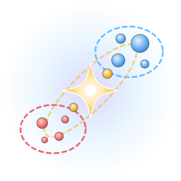
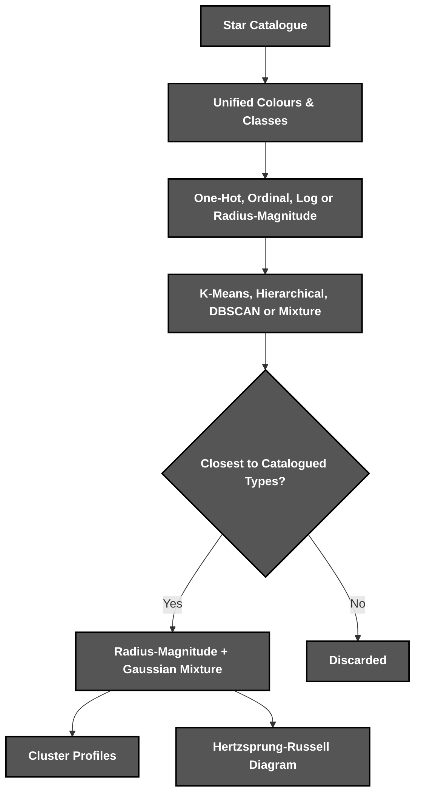
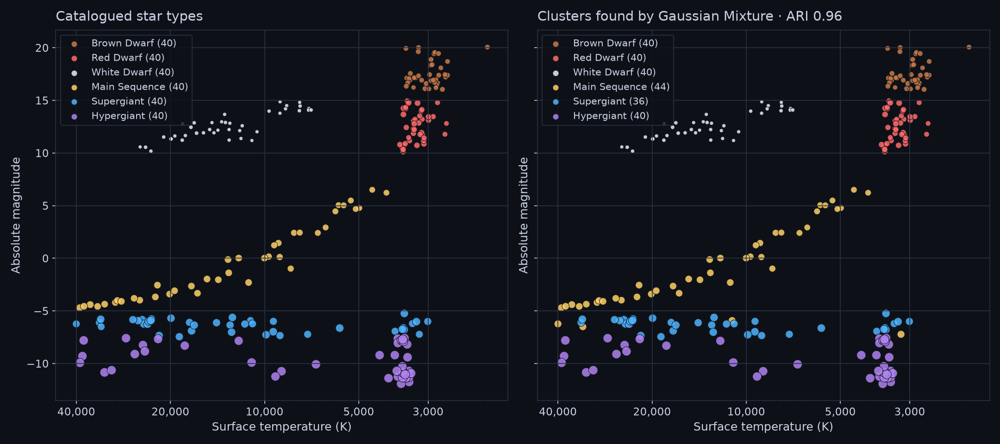

<div align="center">



*A **star type** finder powered by **unsupervised clustering***

</div>

# 📝 **Description**

<div align="center">

***Star Sort*** is an **unsupervised clustering tool** that groups stars into types from their temperature, luminosity, radius and magnitude, and draws them on a ***Hertzsprung-Russell*** diagram
</div>
<br>
<div align="right">

***It was born as a third-year university project*** 🎓

</div>

# 🛠️ **Star Sort Architecture & Workflow**

<div align="center">


</div>

# 📁 **Project Structure**

```
star-sort/
├── .gitattributes                                      # Git Attributes Configuration
├── .gitignore                                          # Git Ignore Rules
├── LICENSE                                             # Project License
├── pyproject.toml                                      # Package & Tool Configuration
├── README.md                                           # You are here! ⬅️
│
├── .github/workflows/
│   └── ci.yml                                          # Lint & Test Pipeline
│
├── assets/                                             # Visual Assets
│   ├── diagram.png                                     # Hertzsprung-Russell Diagram
│   └── logo.svg                                        # Star Sort Logo
│
├── src/starsort/
│   ├── cli.py                                          # Command-Line Interface
│   ├── data.py                                         # Catalogue Loading & Cleaning
│   ├── encoding.py                                     # Feature Encodings
│   ├── kmeans.py                                       # K-Means From Scratch
│   ├── clustering.py                                   # Clustering Algorithms
│   ├── evaluation.py                                   # Scores, Profiles & Benchmarks
│   ├── plotting.py                                     # Hertzsprung-Russell Diagram
│   │
│   └── data/
│       └── stars.csv                                   # 240 Catalogued Stars
│
└── tests/                                              # Unit & Regression Tests
```

# 🔧 **Installation**

## 📋 Requirements

- **Python 3.10+**

## ⚙️ Quick Setup

1. **Clone the repository**
   ```bash
   git clone https://github.com/cristiangilsanz/star-sort.git
   cd star-sort
   ```

2. **Create a virtual environment** *(recommended)*
   ```bash
   python -m venv .venv
   source .venv/bin/activate      # Windows: .venv\Scripts\activate
   ```

3. **Install Star Sort**
   ```bash
   pip install -e .
   ```

<br>

# 🚀 **See *Star Sort* in Action**

## 🌟 To Group the Stars:

1. **Cluster the bundled catalogue and describe each group:**

```bash
star-sort cluster
```

```
Gaussian Mixture on the Radius-Magnitude encoding (k=6, full covariance)

Cluster  Stars  Temperature  Luminosity  Radius  Magnitude  Class   Closest Type  Purity
1           40      2,935 K     0.00052   0.106      17.14      M    Brown Dwarf    100%
2           40      3,314 K     0.00315   0.338      12.61      M      Red Dwarf    100%
3           40     13,380 K     0.00076  0.0102      12.34      B    White Dwarf    100%
4           44     12,560 K       940.5     5.9      -2.00      B  Main Sequence     91%
5           36     12,821 K     244,645    51.5      -6.23      O     Supergiant    100%
6           40      3,766 K     266,500   1,352      -9.91      M     Hypergiant    100%

Adjusted Rand index against the catalogued types: 0.961
```

2. **Draw the groups on a Hertzsprung-Russell diagram:**

```bash
star-sort plot
```

3. **Your diagram is saved to diagram.png, next to the catalogued types**

## 📊 To Compare the Pipelines:

1. **Run every encoding against every algorithm:**

```bash
star-sort compare
```

```
Encoding                 Algorithm  Clusters  Noise  Silhouette    ARI                 Settings
Ordinal                    K-Means         6      0       0.564  0.496                      k=6
Ordinal               Hierarchical         6      0       0.554  0.544                k=6, ward
Ordinal                     DBSCAN         4     22       0.548  0.413  eps=0.85, min_samples=5
Ordinal           Gaussian Mixture         6      0       0.490  0.548     k=6, full covariance
Radius-Magnitude           K-Means         6      0       0.670  0.852                      k=6
Radius-Magnitude      Hierarchical         6      0       0.669  0.840                k=6, ward
Radius-Magnitude            DBSCAN         4      0       0.601  0.680  eps=0.20, min_samples=5
Radius-Magnitude  Gaussian Mixture         6      0       0.641  0.961     k=6, full covariance
```

2. **The labels are never used for fitting, only to score how close each grouping comes to the catalogued types**

## ⚡ To Benchmark K-Means:

1. **Compare the from-scratch k-means with scikit-learn:**

```bash
star-sort kmeans
```

```
Dataset          Points  Own Inertia  Library Inertia  Agreement       Own  Library
Stars               240        10.35            10.34      0.991    6.3 ms  27.4 ms
Synthetic blobs   2,000       119.28           119.28      1.000   36.3 ms  15.5 ms
Synthetic blobs  20,000      1191.39          1191.41      0.999  591.9 ms  72.7 ms
```

## 🧪 To Run the Tests:

1. **Install the development tools:**

```bash
pip install -e ".[dev]"
```

2. **Run the tests and the linter:**

```bash
pytest
ruff check .
```

# 🔭 **Hertzsprung-Russell Diagram**

<div align="center">
    
</div>

<br>

## ⌨️ Commands

<div align="center">

| Command | Action | Description |
|:---:|---|---|
| `star-sort cluster` | Group Stars | Clusters the stars and profiles each group |
| `star-sort plot` | Draw Diagram | Saves a Hertzsprung-Russell diagram to diagram.png |
| `star-sort compare` | Compare Pipelines | Scores every encoding with every algorithm |
| `star-sort kmeans` | Benchmark K-Means | Compares the own k-means with scikit-learn |

</div>

## 📄 Input Format

<div align="center">

| Column | Required | Description |
|:---:|:---:|---|
| `temperature` | Yes | Surface temperature in kelvin |
| `luminosity` | Yes | Luminosity relative to the Sun |
| `radius` | Yes | Radius relative to the Sun |
| `magnitude` | Yes | Absolute magnitude |
| `color` | Yes | Main colour of the spectrum, any common spelling |
| `spectral_class` | Yes | One of O, B, A, F, G, K or M |
| `type` | No | Catalogued type, used only for scoring |

</div>

# 💡 **Tips for Best Results**

The following tips help you get the most out of ***Star Sort***:

> - Pass ***--data*** to cluster your own catalogue.
> - Use ***--encoding*** and ***--algorithm*** to try any pipeline from the comparison.
> - Write every star's cluster with ***star-sort cluster --out clusters.csv***.

# 📚 **Tech Stack & Other Resources**

## 📦 Tech Stack

### 🧩 **Programming Language**
- [Python](https://docs.python.org/3/)

### 🤖 **Machine Learning**
- [scikit-learn](https://scikit-learn.org/stable/)

### 📊 **Data & Visualisation**
- [pandas](https://pandas.pydata.org/docs/)
- [NumPy](https://numpy.org/doc/)
- [Matplotlib](https://matplotlib.org/stable/)

### 🧪 **Testing**
- [Pytest](https://docs.pytest.org/)

### 🧹 **Code Quality**
- [Ruff](https://docs.astral.sh/ruff/)

### ⚙️ **Continuous Integration**
- [GitHub Actions](https://docs.github.com/actions)

# 🙏 **Credits & Thanks**

This project was created together with ***Paola Herráez Bravo*** 🤝 in our third year of university.

Thanks to everyone who keeps star catalogues open for others to explore ✨.

# 📄 **License**

This project is licensed under the MIT License - see the [LICENSE](LICENSE) file for details.

# 📞 **Get Help & Connect**

- 🐛 [Open an issue](https://github.com/cristiangilsanz/star-sort/issues)
- 📧 cristiangilsanz@gmail.com

<div align="center">
  <br>

  **Made with 💖 for the Astronomy Community**

  [⭐ Star this repo](https://github.com/cristiangilsanz/star-sort) | [🍴 Fork it](https://github.com/cristiangilsanz/star-sort/fork)

  <br>

  <a href="https://www.buymeacoffee.com/cristiangilsanz" target="_blank">
    
  </a>

</div>
